# 🌸 Iris Veri Seti Üzerinde Makine Öğrenmesi Modellerinin Karşılaştırılması

## 1. Projenin Amacı

Bu proje, **Iris çiçek veri seti** üzerinde birden fazla sınıflandırma algoritmasını aynı koşullarda eğitip **karşılaştırmalı olarak değerlendirmeyi** amaçlar. Veri seti, orijinal dört ölçüme (çanak/taç yaprak uzunluk ve genişlikleri) ek olarak **türetilmiş dört özellik** (yaprak uzunluk oranları ve elips alanları) içerir. Toplamda 8 özellik ve 3 tür (`Iris-setosa`, `Iris-versicolor`, `Iris-virginica`) bulunur.

Karşılaştırılan modeller:

- Logistic Regression
- Decision Tree
- Random Forest
- K-Nearest Neighbors (KNN)
- Support Vector Classifier (SVC)
- Gaussian Naive Bayes
- XGBoost

Her model için aynı `train/test` ayrımı (%70 / %30, `stratify` ile, `random_state=42`) kullanılır ve şu metrikler hesaplanır: test/eğitim doğruluğu, 5 katlı çapraz doğrulama, log loss, çok sınıflı ROC-AUC (OvR), sınıflandırma raporu, ROC eğrileri ve karmaşıklık matrisi.

## 2. Kullanılan Teknolojiler ve Kütüphaneler

| Alan | Araç |
|---|---|
| Dil | Python 3.10 |
| Ortam | Jupyter Notebook |
| Veri işleme | NumPy, pandas |
| Görselleştirme | Matplotlib, Seaborn |
| Modelleme | scikit-learn (`LogisticRegression`, `DecisionTreeClassifier`, `RandomForestClassifier`, `KNeighborsClassifier`, `SVC`, `GaussianNB`) |
| Gradyan artırma | XGBoost |
| İstatistik | SciPy (Gaussian yoğunluk grafikleri için) |
| Ön işleme / metrik | `StandardScaler`, `LabelEncoder`, `LabelBinarizer`, `cross_val_score`, `roc_auc_score`, `log_loss`, `classification_report` |

## 3. Sonuçlar

### Özet Tablo

| Model | Test Doğruluğu | Eğitim Doğruluğu | 5-Kat CV Ort. | Log Loss | ROC-AUC (macro, OvR) |
|---|---|---|---|---|---|
| Logistic Regression | 0.9333 | 0.9714 | 0.9619 | 0.1663 | 1.00 |
| Decision Tree | 0.8889 | 0.9714 | 0.9333 | 3.2539 | 0.93 |
| Random Forest | 0.9333 | 0.9905 | 0.9619 | 0.1567 | 0.99 |
| KNN | 0.9111 | 0.9619 | 0.9429 | 0.1676 | 0.99 |
| SVC (poly) | 0.9111 | 0.9524 | 0.9048 | 0.2140 | 1.00 |
| Gaussian Naive Bayes | 0.9111 | 0.9810 | 0.9714 | 0.3130 | 0.99 |
| XGBoost | 0.9333 | 1.0000 | 0.9524 | 0.1687 | 0.99 |

> Test kümesi 45 örnekten oluştuğundan modeller arasındaki küçük farklar istatistiksel olarak anlamlı olmayabilir.

### ROC Eğrileri ve Karmaşıklık Matrisleri

#### Logistic Regression
| ROC Eğrisi | Karmaşıklık Matrisi |
|:---:|:---:|
| 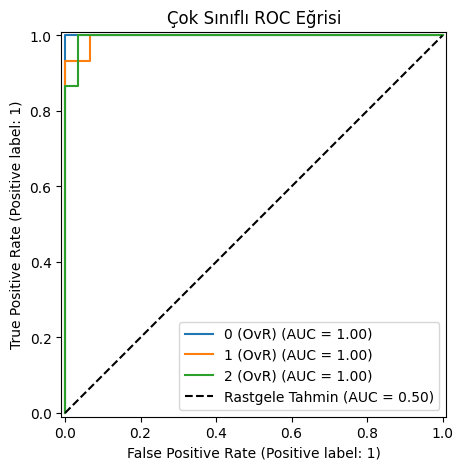 | 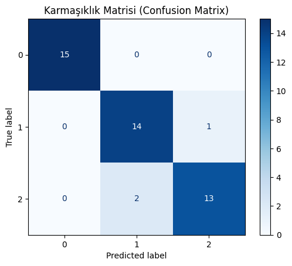 |

#### Decision Tree
| ROC Eğrisi | Karmaşıklık Matrisi |
|:---:|:---:|
| 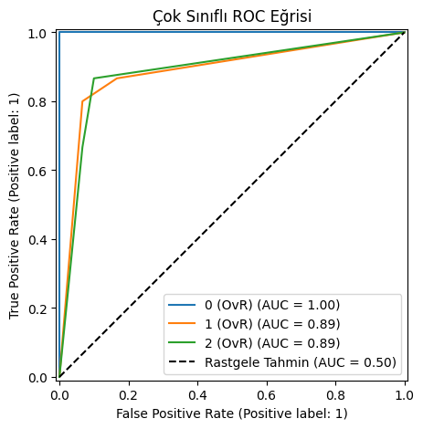 | 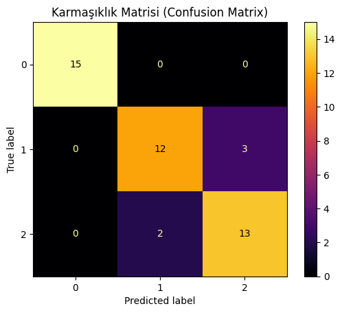 |

#### Random Forest
| ROC Eğrisi | Karmaşıklık Matrisi |
|:---:|:---:|
| 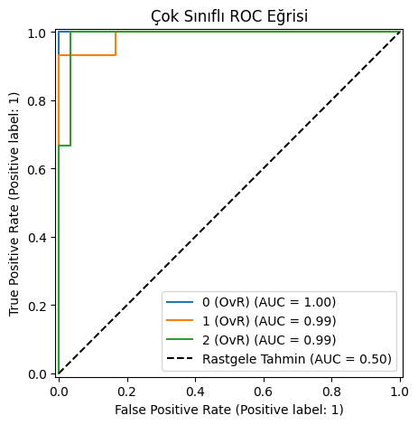 | 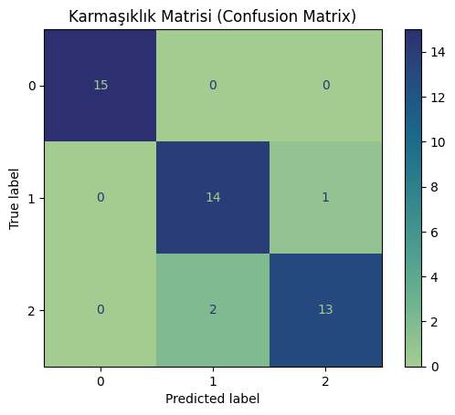 |

#### K-Nearest Neighbors
| ROC Eğrisi | Karmaşıklık Matrisi |
|:---:|:---:|
| 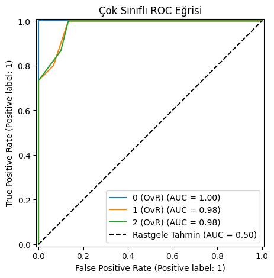 | 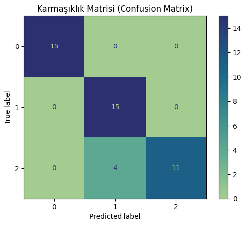 |

#### Support Vector Classifier
| ROC Eğrisi | Karmaşıklık Matrisi |
|:---:|:---:|
| 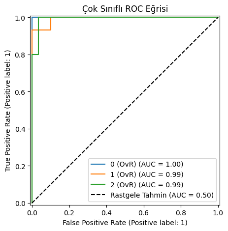 | 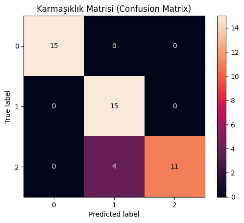 |

#### Gaussian Naive Bayes
| ROC Eğrisi | Karmaşıklık Matrisi |
|:---:|:---:|
| 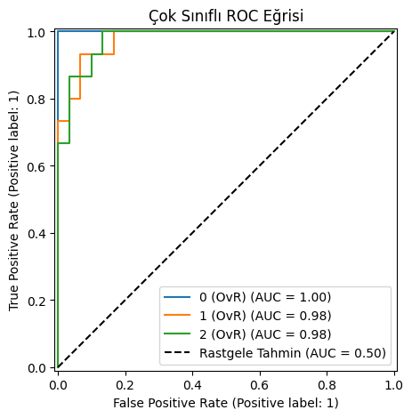 | 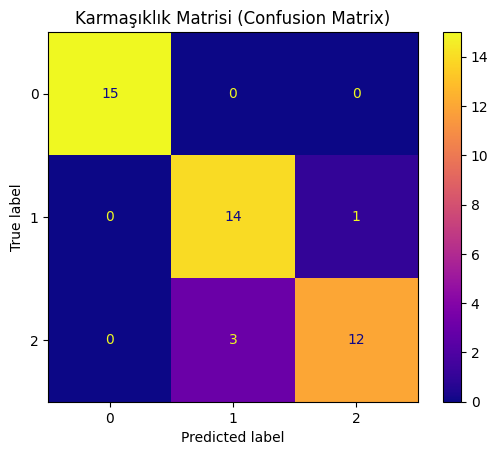 |

<details>
<summary>Gaussian Naive Bayes – özellik başına sınıf yoğunluk dağılımları</summary>

<table>
<tr>
<td>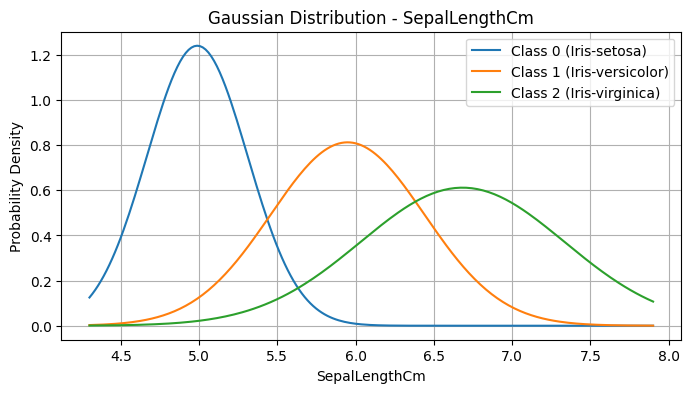</td>
<td>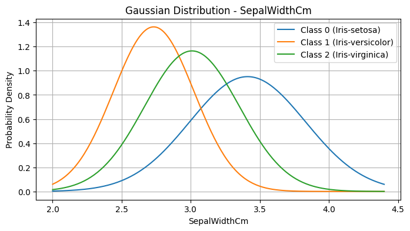</td>
</tr>
<tr>
<td>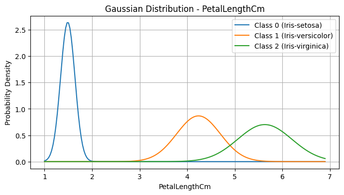</td>
<td>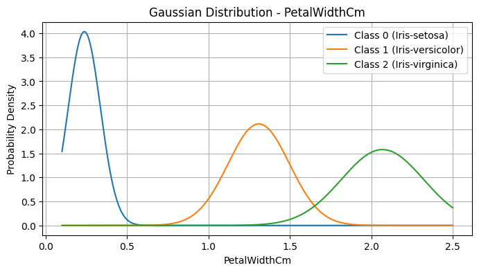</td>
</tr>
<tr>
<td>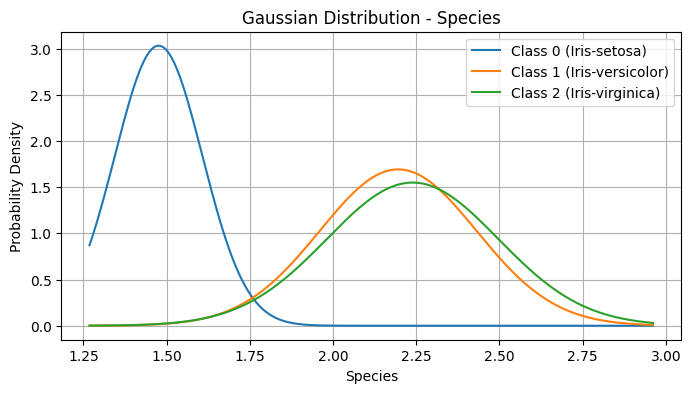</td>
<td>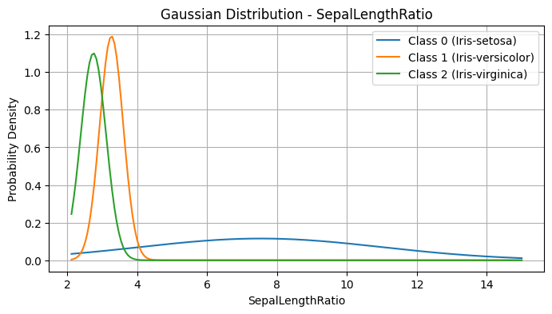</td>
</tr>
<tr>
<td>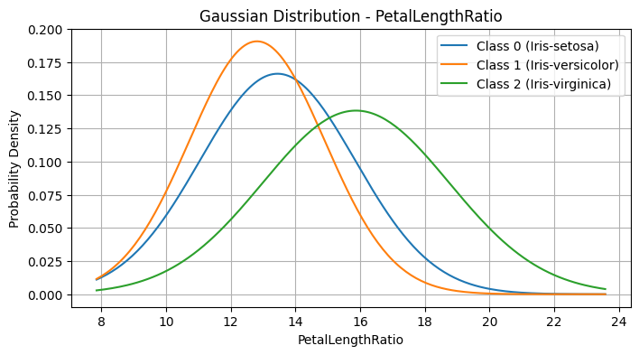</td>
<td>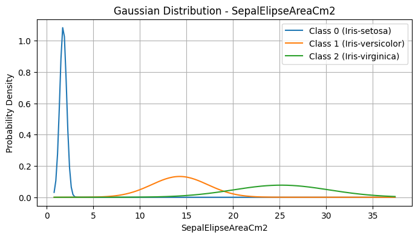</td>
</tr>
</table>

</details>

#### XGBoost
| ROC Eğrisi | Karmaşıklık Matrisi |
|:---:|:---:|
| 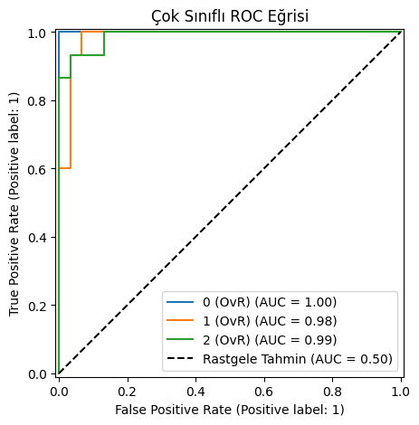 | 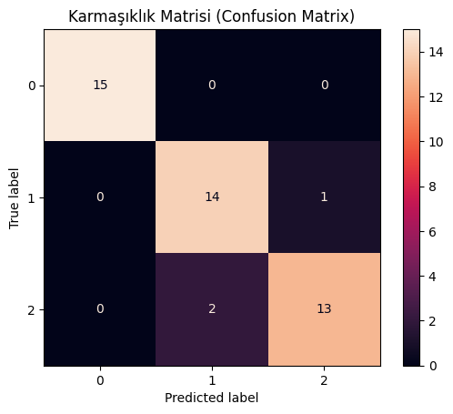 |

## 4. Kurulum

1. Depoyu klonlayın:

   ```bash
   git clone https://github.com/Ayberk-Aktan/<repo-adi>.git
   cd <repo-adi>
   ```

2. (Önerilen) Sanal ortam oluşturup etkinleştirin:

   ```bash
   python -m venv venv
   # Windows
   venv\Scripts\activate
   # macOS / Linux
   source venv/bin/activate
   ```

3. Gerekli kütüphaneleri `requirements.txt` ile tek komutta yükleyin:

   ```bash
   pip install -r requirements.txt
   ```

   `requirements.txt` şu paketleri içerir (Python 3.10 veya üzeri önerilir):

   | Paket | Minimum sürüm |
   |---|---|
   | numpy | 1.23 |
   | pandas | 1.5 |
   | matplotlib | 3.6 |
   | seaborn | 0.12 |
   | scipy | 1.9 |
   | scikit-learn | 1.2 |
   | xgboost | 1.7 |
   | notebook | 6.5 |
   | ipykernel | 6.0 |

4. `new_Iris.csv` dosyasının `ml_models.ipynb` ile aynı klasörde olduğundan emin olun.

5. Notebook'u başlatın ve hücreleri sırayla çalıştırın:

   ```bash
   jupyter notebook ml_models.ipynb
   ```

## 5. Lisans

Bu proje **MIT Lisansı** ile lisanslanmıştır. Ayrıntılar için [LICENSE](LICENSE) dosyasına bakabilirsiniz.

## 6. İletişim

**Ayberk Aktan**

- GitHub: [Ayberk-Aktan](https://github.com/Ayberk-Aktan)
- LinkedIn: [Ayberk Aktan](https://www.linkedin.com/in/ayberk-aktan-3553a524a/)
